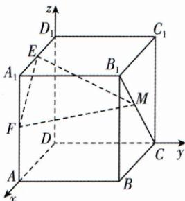

> [!faq]- 2026版 必刷题 数学选择性必修第一册RJA
> **【答案】** C
>
> **【解析】**
> 以 $D$ 为原点， $DA, DC, DD_{1}$ 所在直线分别为 $x, y, z$ 轴，建立如图所示的空间直角坐标系 $Dxyz$ .
> 设正方体的棱长为 2，则 $D(0,0,0)$ ， $D_{1}(0,0,2)$ ， $A(2,0,0)$ ， $A_{1}(2,0,2)$ ， $E(1,0,2)$ ， $F(2,0,1)$ ，由 $M$ 在线段 $B_{1}C$ 上，可设 $M(x,2,x)$ ， $0 \leqslant x \leqslant 2$ ，则 $\overrightarrow{EM} = (x - 1,2,x - 2)$ ， $\overrightarrow{EF} = (1,0,-1)$ ， $\overrightarrow{DD_{1}} = (0,0,2)$ .
> 设平面 $MEF$ 的法向量为 $n = (a,b,$ c)，则 $\left\{ \begin{array}{l} n \cdot \overrightarrow{EF} = 0, \\ n \cdot \overrightarrow{EM} = 0, \end{array} \right.$ 即 $\left\{ \begin{array}{l} a - c = 0, \\ a(x - 1) + 2b + c(x - 2) = 0, \end{array} \right.$ 令 $a = 1$ ，得 $c = 1, b = \frac{3 - 2x}{2}$ ，则平面 $MEF$ 的一个法向量为 $n = \left(1, \frac{3 - 2x}{2}, 1\right)$ ，
> 设直线 $DD_{1}$ 与平面 $MEF$ 所成角为 $\theta$ ，
> 则 $\sin \theta = |\cos \langle \overrightarrow{DD_{1}}, n\rangle| = \frac{|\overrightarrow{DD_{1}} \cdot n|}{|\overrightarrow{DD_{1}}||n|} = \frac{2}{2\sqrt{1^2 + \frac{(3 - 2x)^2}{4} + 1^2}} = \frac{1}{\sqrt{\left(x - \frac{3}{2}\right)^2 + 2}}$ ，
> 因为 $0 \leqslant x \leqslant 2$ ，所以当 $x = \frac{3}{2}$ 时， $\text{追坑：注意变量 } x$ 的取值范围 $\sqrt{\left(x - \frac{3}{2}\right)^2 + 2}$ 取得最小值 $\sqrt{2}$ ,
> 即 $\sin \theta$ 取得最大值 $\frac{\sqrt{2}}{2}$ ，由 $\theta \in [0, \frac{\pi}{2}]$ ，可得 $\theta$ 的最大值为 $\frac{\pi}{4}$ .
> 所以直线 $DD_{1}$ 与平面 $MEF$ 所成角的最大值为 $\frac{\pi}{4}$ . 故选 C.
> 
