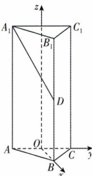

> [!faq]- 必刷题解析
> **【答案】** B
>
> **【解析】**
> 取 $AC$ 的中点 $O$ , 连接 $OB$ , 则 $OB = \frac{\sqrt{3}}{2} AB = \frac{\sqrt{3}}{2}$ , 以 $O$ 为原点, 建立如图所示的空间直角坐标系, 则 $A_{1}\left(0, -\frac{1}{2}, 2\right), D\left(\frac{\sqrt{3}}{2}, 0, 1\right), \therefore \overrightarrow{A_{1}D} = \left(\frac{\sqrt{3}}{2}, \frac{1}{2}, -1\right)$ , 由图可知, 平面 $AA_{1}C_{1}C$ 的一个法向量 [116]
为 $\boldsymbol{n}=(1,0,0)$ .
设 $A_{1}D$ 与平面 $AA_{1}C_{1}C$ 所成的角为 $\theta$ ，则 $\sin\theta=|\cos\langle\overrightarrow{A_{1}D},n\rangle|=\frac{|\overrightarrow{A_{1}D}\cdot n|}{|\overrightarrow{A_{1}D}||n|}=\frac{\sqrt{3}}{2}=\frac{\sqrt{6}}{4}$ ，故 $A_{1}D$ 与平面 $AA_{1}C_{1}C$ 所成的角的正弦值为 $\frac{\sqrt{6}}{4}$ . 故选 B.

对应题目：[Q070000003979](../Q070000003979.md)

> 来源：2026版 必刷题 数学选择性必修第一册RJA
