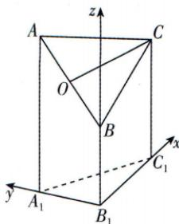
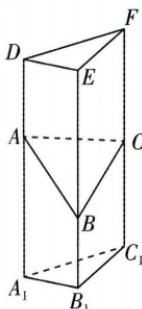

> [!faq]- 2026版 必刷题 数学选择性必修第一册RJA
> **【解析】**
> （1）【证明】由题可得 $BB_{1} \perp$ 平面 $A_{1}B_{1}C_{1}$ ，又 $A_{1}B_{1},B_{1}C_{1}\subset$ 平面
> $A_{1}B_{1}C_{1}$ ，所以 $BB_{1}\bot A_{1}B_{1},BB_{1}\bot B_{1}C_{1}$
> 又因为 $\angle A_{1}B_{1}C_{1} = 90^{\circ}$ ，所以可以以 $B_{1}$ 为坐标原点建立空间直角坐标系，如图①，则 $C_1(1,0,$
> 
> 图①
> $$
> 0), C (1, 0,
> $$
> 3), $A_{1}(0,1,0), A(0,1,4), B(0,0,2)$ , 因为 $O$ 是 $AB$ 的中点, 所以 $O\left(0, \frac{1}{2}, 3\right), \overrightarrow{OC} = \left(1, -\frac{1}{2}, 0\right)$ , 易知 $\boldsymbol{n} = (0,0,1)$ 是平面 $A_{1}B_{1}C_{1}$ 的一个法向量, $\overrightarrow{OC} \cdot \boldsymbol{n} = 0$ , 又 $OC \notin$ 平面 $A_{1}B_{1}C_{1}$ , 所以 $OC / /$ 平面 $A_{1}B_{1}C_{1}$ .
> (2)【解】设直线 $AB$ 与平面 $AA_{1}C_{1}C$ 所成的角为 $\theta, \overrightarrow{A_1A} = (0, 0, 4), \overrightarrow{A_1C_1} = (1, -1, 0)$ ，设 $m = (x, y, z)$ 是平面 $AA_{1}C_{1}C$ 的法向量，则由 $\left\{ \begin{array}{l} \overrightarrow{A_1A} \cdot m = 0, \\ \overrightarrow{A_1C_1} \cdot m = 0, \end{array} \right.$ 得 $\left\{ \begin{array}{l} z = 0, \\ x - y = 0, \end{array} \right.$ 取 $x = 1$ ，得 $m = (1, 1, 0)$ . 又因为 $\overrightarrow{AB} = (0, -1, -2)$ ，所以 $\cos \langle m, \overrightarrow{AB} \rangle = \frac{m \cdot \overrightarrow{AB}}{|m| |\overrightarrow{AB}|} = -\frac{\sqrt{10}}{10}$ ，则 $\sin \theta = \frac{\sqrt{10}}{10}, \cos \theta = \frac{3\sqrt{10}}{10}$ ，所以直线 $AB$ 与平面 $AA_{1}C_{1}C$ 所成的角的余
> 弦值为 $\frac{3\sqrt{10}}{10}$ .
> (3)【解】分别延长 $A_{1}A, B_{1}B, C_{1}C$ 至点 D,
> E, F, 使 AD = 2, BE = 4,
> CF = 3, 如图②, 则 $V_{ABC-A_{1}B_{1}C_{1}}=\frac{1}{2}V_{DEF-A_{1}B_{1}C_{1}}=$ 巧思：运用补形法
> 
> 图②
> 求不规则几何体的体积，事半功倍 $\frac{1}{2}\times \left(\frac{1}{2}\times 1\times 1\right)\times 6 = \frac{3}{2}.$ 因此该几何体的体积为 $\frac{3}{2}$
