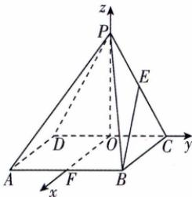

> [!faq]- 必刷题解析
> **【答案】** C
>
> **【解析】**
> 过点 $P$ 作 $PO \perp DC$ 交 $DC$ 于点 $O$ , 过点 $O$ 作 $OF \perp AB$ 交 $AB$ 于点 $F$ ,

因为侧面 PDC 是正三角形, 底面 AB-CD 是正方形, 所以 O 是 CD 的中点, F 是 AB 的中点,
又因为平面 $PDC \perp$ 底面 ABCD, 平面 $PDC \cap$ 平面 $ABCD = CD, PO \subset$ 平面 $PDC, PO \perp CD$ , 所以 $PO \perp$ 底面 ABCD.
所以易知 OF, OC, OP 两两垂直，
以 O 为坐标原点，OF, OC, OP 所在直线分别为 x, y, z 轴建立如图所示的空间直角坐标系. 设 AB = 2，则 A(2, -1, 0), B(2, 1, 0), P(0, 0, $\sqrt{3}$ ), E(0, $\frac{1}{2}, \frac{\sqrt{3}}{2}$ ), 则 $\overrightarrow{AP} = (-2, 1, \sqrt{3})$ , $\overrightarrow{BE}=\left(-2,-\frac{1}{2},\frac{\sqrt{3}}{2}\right)$ 所以 $\cos\theta=|\cos\langle\overrightarrow{AP},\overrightarrow{BE}\rangle|=$ $\frac{|\overrightarrow{AP}\cdot\overrightarrow{BE}|}{|\overrightarrow{AP}||\overrightarrow{BE}|}=\frac{\left|4-\frac{1}{2}+\frac{3}{2}\right|}{2\sqrt{2}\times\sqrt{5}}=\frac{5}{2\sqrt{10}}=\frac{\sqrt{10}}{4}$ .
>
> 故选 **C**.

对应题目：[Q070000003990](../Q070000003990.md)

> 来源：2026版 必刷题 数学选择性必修第一册RJA
