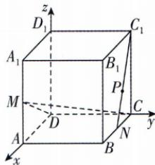

> [!faq]- 必刷题解析
> **【答案】** B
>
> **【解析】**
> 以 $D$ 为坐标原点， $DA, DC, DD_{1}$ 所在直线分别为 $x, y, z$ 轴，建立如图所示的空间直角坐标系，连接 $NC_{1}$ ，则 $D(0,0,0), C(0,2,0), M(2,0,1), N(1,2,0), C_{1}(0,2,2)$ ，则 $\overrightarrow{NC_{1}} = (-1, 0,2), \overrightarrow{DC} = (0,2,0), \overrightarrow{DM} = (2,0,1)$ . 故 $\overrightarrow{NC_{1}} \cdot \overrightarrow{DC} = (-1,0,2) \cdot (0,2,0) = 0, \overrightarrow{NC_{1}} \cdot \overrightarrow{DM} = (-1,0,2) \cdot (2,0,1) = -2 + 2 = 0,$ 所以 $NC_{1} \perp DC, NC_{1} \perp DM$ ，又 $DC \cap DM = D, DC, DM \subset$ 平面 $MDC$ ，所以 $NC_{1} \perp$ 平面 $MDC$ . 故当点 $P$ 在线段 $NC_{1}$ （不包含点 $N$ ）上运动时，满足 $NP \perp$ 平面 $MDC$ ，因此点 $P$ 的轨迹长度为 $NC_{1} = \sqrt{1^{2} + 2^{2}} = \sqrt{5}$ . 故选 B.

对应题目：[Q070000004000](../Q070000004000.md)

> 来源：2026版 必刷题 数学选择性必修第一册RJA
