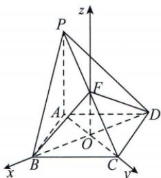

> [!faq]- 必刷题解析
> **【答案】** D
>
> **【解析】**
> 如图, 设 BD 与 AC 交于点 O, 连接 OF. ∵ 四边形 ABCD 为菱形, ∴ O 为 AC 的中点, $AC \perp BD$ . ∵ F 为 PC 的中点, ∴ $OF \parallel PA$ . ∵ $PA \perp$ 平面 ABCD, ∴ $OF \perp$ 平面 ABCD. 以 O 为原点, OB, OC, OF 所在直线分别为 x 轴、y 轴、z 轴建立空间直角坐标系 Oxyz. 设 PA = AD = AC = 1, 则 $BD = \sqrt{3}$ ,

$\therefore B\left(\frac{\sqrt{3}}{2},0,0\right),F\left(0,0,\frac{1}{2}\right),C\left(0,\frac{1}{2},0\right),D\left(-\frac{\sqrt{3}}{2},0,0\right),\therefore \overrightarrow{OC} =$ $\left(0,\frac{1}{2},0\right)$ ，结合图形可知， $\overrightarrow{OC}$ 为平面BDF的一个法向量.由 $\overrightarrow{BC} =$ $\left(-\frac{\sqrt{3}}{2},\frac{1}{2},0\right),\overrightarrow{FB} = \left(\frac{\sqrt{3}}{2},0, - \frac{1}{2}\right)$ ，可求得平面BCF的一个法向量为 $n = (1,\sqrt{3},\sqrt{3}).$ $\therefore \cos \langle n,\overrightarrow{OC}\rangle = \frac{\sqrt{21}}{7}$ 又二面角 $C-$ $BF - D$ 为锐二面角， $\therefore \sin \langle n,\overrightarrow{OC}\rangle =$ $\frac{2\sqrt{7}}{7},\therefore \tan \langle n,\overrightarrow{OC}\rangle = \frac{2\sqrt{3}}{3}.$
>
> 故选 **D**.

对应题目：[Q070000004010](../Q070000004010.md)

> 来源：2026版 必刷题 数学选择性必修第一册RJA
