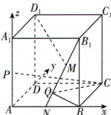

> [!faq]- 2026版 必刷题 数学选择性必修第一册RJA
> **【答案】** C
>
> **【解析】**
> 由 $\overrightarrow{AM} = \lambda \overrightarrow{AB} + \mu \overrightarrow{AA_{1}}, \lambda, \mu \in [0,1]$ ，知点 M 在平面 $ABB_{1}A_{1}$ 内。以 A 为原点，AB, AD, $AA_{1}$ 所在直线分别为 x, y, z 轴建立空间直角坐标系，如图所示。
> 
> 则 $P(0,0,2),C(4,4,0),D_1(0,4,$ 4)，设 $M(a,0,b),a,b\in [0,4]$ ，则 $\overrightarrow{D_1M} = (a, - 4,b - 4),\overrightarrow{CP} = (-4, - 4,2)$ 由 $D_{1}M\bot CP$ ，得 $\overrightarrow{D_1M}\cdot \overrightarrow{CP} = -4a + 16+$ $2b - 8 = 0$ ，即 $b = 2a - 4.$ 取 $AB$ 的中点 $N$ ，连接 $B_{1}N$ ，则点 $M$ 的轨迹为线段 $B_{1}N$ ，过点 $B$ 作 $BQ\perp$ $B_{1}N$ ，垂足为 $Q$ ，连接 $CQ$
> 则 $BQ=\frac{BB_{1}\cdot BN}{B_{1}N}=\frac{4\times2}{\sqrt{2^{2}+4^{2}}}=\frac{4\sqrt{5}}{5}.$ 又 $BC \perp$ 平面 $ABB_{1}A_{1}, BQ \subset$ 平面 $ABB_{1}A_{1}$ ，故 $BC \perp BQ$ ，
> 所以 $S_{\triangle BCM}$ 的最小值为 $S_{\triangle QBC} = \frac{1}{2} \times 4 \times \frac{4\sqrt{5}}{5} = \frac{8\sqrt{5}}{5}$ .
>
> 故选 **C**.
