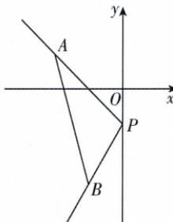

> [!faq]- 必刷题解析
> **【答案】** D
>
> **【解析】**
> 依题意, 直线 PA 的斜率 $k_{PA} = \frac{-1 - 1}{2} = -1$ , 直线 PB 的斜率 $k_{PB} = \frac{-\sqrt{3} - 1 + 1}{-1} = \sqrt{3}$ ,
由直线 l 与线段 AB 总有公共点, 得直线 l 的斜率 $k \in [-1, \sqrt{3}]$ ，即 $-1 \leqslant \tan \alpha \leqslant \sqrt{3}$ 当 $-1 \leqslant \tan \alpha < 0$ 时，又 $\alpha \in [0, \pi)$ ，则 $\frac{3\pi}{4} \leqslant \alpha < \pi$ ; 当 $0 \leqslant \tan \alpha \leqslant \sqrt{3}$ 时，又 $\alpha \in [0, \pi)$ ，得 $0 \leqslant \alpha \leqslant \frac{\pi}{3}$ ，所以 l 的倾斜角 $\alpha$ 的取值范围为 $\left[0, \frac{\pi}{3}\right] \cup \left[\frac{3\pi}{4}, \pi\right)$ . 故选 D.

>
> ---
> **⚠️ 易错警示**
> 用 $\alpha$ 表示直线的倾斜角, 则当 $0^{\circ} \leqslant \alpha < 90^{\circ}$ 时, 随着 $\alpha$ 的增大, 直线的斜率 k 为非负值且逐渐变大; 当 $90^{\circ} < \alpha < 180^{\circ}$ 时, 随着 $\alpha$ 的增大, 直线的斜率 k 为负值且逐渐变大.

## 第2.1节综合训练

## 刷能力

对应题目：[Q070000004041](../Q070000004041.md)

> 来源：2026版 必刷题 数学选择性必修第一册RJA
