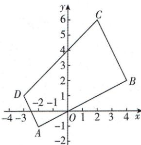

> [!faq]- 必刷题解析
> **【答案】** D
>
> **【解析】**
> 如图,由题知 $k_{AD}=\frac{1+1}{-3+2}=-2$ , $k_{BC}=\frac{6-2}{2-4}=-2$ , 所以 $k_{AD}=k_{BC}$ , 所以 $AD \parallel BC$ . 又 $k_{AB}=\frac{2+1}{4+2}=\frac{1}{2}$ , 所以 $k_{AB} \cdot k_{BC}=-1$ , 所以 $AB \perp BC$ .
又 $\left|AD\right|=\sqrt{2^{2}+1^{2}}=\sqrt{5},\left|BC\right|=\sqrt{4^{2}+2^{2}}=2\sqrt{5}\neq\left|AD\right|$ 所以四边形 ABCD 是直角梯形. 故选 D.

对应题目：[Q070000004046](../Q070000004046.md)

> 来源：2026版 必刷题 数学选择性必修第一册RJA
