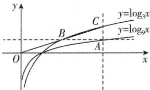

> [!faq]- 必刷题解析
> **【解析】**
> $\frac{\log_32}{2}$ 【解析】不妨设 $A(x_0, \frac{1}{2}\log_3x_0)$ ，则 $B(\sqrt{x_0}, \frac{1}{2}\log_3x_0)$ ， $C(x_0, \log_3x_0)$ ，由题意可得 $k_{BO} = k_{OC} \Rightarrow \frac{\log_3x_0}{x_0} = \frac{\frac{1}{2}\log_3x_0}{\sqrt{x_0}}$ ，点悟：利用 $O, B, C$ 三点共线时斜率之间的关系求 $x_0$ 解得 $x_0 = 4$ 或 $x_0 = 1$ ，经过检验 $x_0 = 1$ 不符合题意，故舍去，故直线 $BC$ 的斜率为 $\frac{\log_34}{4} = \frac{\log_32}{2}$ .

## 2.2 直线的方程

对应题目：[Q070000004050](../Q070000004050.md)

> 来源：2026版 必刷题 数学选择性必修第一册RJA
