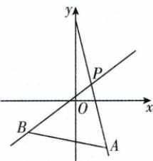

> [!faq]- 必刷题解析
> **【答案】** A
>
> **【解析】**
> 如图, 设直线 l 过定点 $P(x,y)$ , 直线 $l: mx + y - m - 1 = 0$ 可变形为 $m(x - 1) + y - 1 = 0$ ,
令 $\left\{\begin{aligned}x-1&=0,\\ y-1&=0,\end{aligned}\right.$ 解得 $\left\{\begin{aligned}x&=1,\\ y&=1.\end{aligned}\right.$ 故直线l必过定点P(1,1).又A(2,-3),B(-3,-2),所以直线PA的斜率 $k_{PA}=\frac{-3-1}{2-1}=-4$ ,直线PB的斜率 $k_{PB}=\frac{-2-1}{-3-1}=\frac{3}{4}$ .
已知直线 l:mx+y-m-1=0 与线段 AB 相交，由图知， $-m\geqslant\frac{3}{4}$ 或 $-m\leqslant-4$ ，解得 $m\leqslant-\frac{3}{4}$ 或 $m\geqslant4$ ，则实数m的取值范围是 $\left(-\infty,-\frac{3}{4}\right]\cup[4,+\infty)$ .故选A.

## 刷易错
★易错点 两条直线相交求参数时考虑不全面致误

对应题目：[Q070000004094](../Q070000004094.md)

> 来源：2026版 必刷题 数学选择性必修第一册RJA
