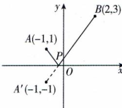
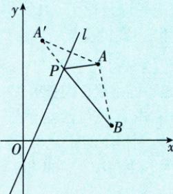
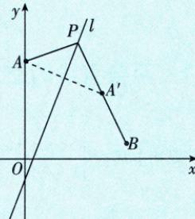

> [!faq]- 必刷题解析
> **【答案】** B
>
> **【解析】**
> 已知 $A(-1,1)$ , $B(2,3)$ ，点 P 在 x 轴上，如图，

取 $A(-1,1)$ 关于 $x$ 轴的对称点为 $A^{\prime}(-1, - 1)$ ，连接 $A^{\prime}B$ 交 $x$ 轴于点 $P,|PA| + |PB| = |PA^{\prime}| + |PB|\geqslant$ $|A'B| = \sqrt{(2 + 1)^2 + (3 + 1)^2} = 5.$ 所以 $|PA| + |PB|$ 的最小值为5.
>
> 故选 **B**.
>
> ---
> **💡 规律方法**
> 求直线 l 上一点 P 到两定点 A, B 距离之和的最小值, 若两定点在直线 l 的同侧, 则可取点 A 关于直线 l 的对称点 $A'$ , 如图①, 则 $|PA| = |PA'|$ , $(|PA| + |PB|)_{\min} = |A'B|$ ; 若两定点在直线 l 的两侧, 则 $|AB|$ 即为所求.

图①
求直线 l 上一点 P 到两定点 A, B 距离之差的最大值，若两定点在直线 l 的同侧，则 $\left|\left|PA\right|-\left|PB\right|\right|_{\max}=\left|AB\right|$ ；若两定点在直线 l 的两侧，则可取点 A 关于直线 l 的对称点 $A'$ ，如图②，则 $\left|PA\right|=\left|PA'\right|,\left|\left|PA\right|-\left|PB\right|\right|_{\max}=\left|\left|PA'\right|-\left|PB\right|\right|_{\max}=\left|A'B\right|$ .

图②
这类最值问题,可以由对称性及平面几何知识转化,利用(1)三角形任意两边之和大于第三边;(2)三角形任意两边之差的绝对值小于第三边;(3)两点之间线段最短求解.

对应题目：[Q070000004099](../Q070000004099.md)

> 来源：2026版 必刷题 数学选择性必修第一册RJA
