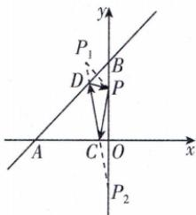

> [!faq]- 2026版 必刷题 数学选择性必修第一册RJA
> **【答案】** C
>
> **【解析】**
> 由题可得直线 $AB$ 的方程为 $y = x + 3$ ，设点 $P(0,2)$ 关于直线 $y = x + 3$ 的对称点为 $P_{1}(a,b)$ 则 $\left\{ \begin{array}{l} \frac{b - 2}{a} = -1, \\ \frac{b + 2}{2} = \frac{a}{2} +3, \end{array} \right.$ 得 $\left\{ \begin{array}{l} a = -1, \\ b = 3, \end{array} \right.$ 即 $P_{1}(-1,3)$ . 点 $P(0,2)$ 关于 $x$ 轴的对称点为 $P_{2}(0, - 2)$ . 如图，由题意可知，点 $P_{1}, P_{2}$ 都在直线 $CD$ 上，并且利用对称性可知， $|DP| = |DP_{1}|, |CP| = |CP_{2}|$ ，所以光线经过的路程 $|PC| + |CD| + |DP| = |CP_{2}| + |CD| + |DP_{1}| = |P_{1}P_{2}| = \sqrt{26}$ . 故选C.
> 
