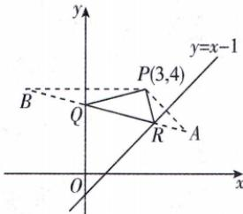

> [!faq]- 必刷题解析
> **【解析】**
> 2 $\sqrt{17}$ 【解析】设点 $P(3,4)$ 关于直线 $y = x - 1$ 的对称点为 $A(m,n)$ ，则 $\left\{ \begin{array}{l} \frac{n + 4}{2} = \frac{m + 3}{2} - 1, \\ \frac{n - 4}{m - 3} \cdot 1 = -1, \end{array} \right.$ 解得 $\left\{ \begin{array}{l} m = 5, \\ n = 2, \end{array} \right.$
故 $A(5,2)$ 又点 $P(3,4)$ 关于 $y$ 轴的对称点为 $B(-3,4)$ 则 $\vert PQ\vert = \vert BQ\vert ,\vert RA\vert = \vert PR\vert$ 所以 $\triangle PQR$ 的周长为 $\vert PQ\vert +\vert QR\vert +$ $\vert RP\vert = \vert BQ\vert +\vert QR\vert +\vert RA\vert \geqslant \vert AB\vert =$ $\sqrt{(-3 - 5)^2 + (4 - 2)^2} = 2\sqrt{17}$ ，当且仅当 $B,Q,R,A$ 四点共线时， $\triangle PQR$ 的周长取到最小值 $2\sqrt{17}$

对应题目：[Q070000004104](../Q070000004104.md)

> 来源：2026版 必刷题 数学选择性必修第一册RJA
