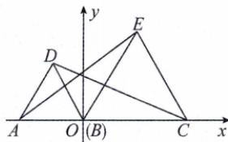

> [!faq]- 2026版 必刷题 数学选择性必修第一册RJA
> **【解析】**
> 【证明】如图,以点 B 为坐标原点,取 AC 所在直线为 x 轴,建立平面直角坐标系 xOy.
> 
> 设 $\triangle ABD$ 和 $\triangle BCE$ 的边长分别为 $a$ 和 $c$ , 则 $A(-a,0), C(c,0), E\left(\frac{c}{2}, \frac{\sqrt{3}c}{2}\right), D\left(-\frac{a}{2}, \frac{\sqrt{3}a}{2}\right)$ , 由两点间距离公式, 得 $|AE| = \sqrt{\left(\frac{c}{2} + a\right)^2 + \left(\frac{\sqrt{3}c}{2} - 0\right)^2} = \sqrt{a^2 + ac + c^2}$ , $|CD| = \sqrt{\left(c + \frac{a}{2}\right)^2 + \left(0 - \frac{\sqrt{3}a}{2}\right)^2} =$
> $$
> \sqrt {a ^ {2} + a c + c ^ {2}}
> $$
> $$
> \text {以} \vert A E \vert = \vert C D \vert
> $$
