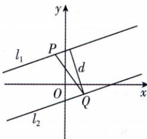

> [!faq]- 必刷题解析
> **【解析】**
> (0,5] 【解析】设 $l_{1}, l_{2}$ 之间的距离为 $d$ ,

若平行直线 $l_{1}, l_{2}$ 分别过点 $P(-1, 3), Q(2, -1)$ ，则 $0 < d \leqslant |PQ| = 5$ ，当且仅当 $l_{1}, l_{2}$ 与直线 PQ 垂直时，等号成立，所以 $l_{1}, l_{2}$ 之间的距离的取值范围是 $(0, 5]$ .

对应题目：[Q070000004124](../Q070000004124.md)

> 来源：2026版 必刷题 数学选择性必修第一册RJA
