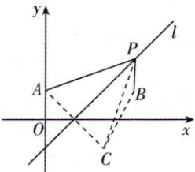

> [!faq]- 必刷题解析
> **【答案】** A
>
> **【解析】**
> 设点 $A(0,1)$ 关于直线 $l$ 的对称点为 $C(x_0,y_0)$ ，则有 $\left\{ \begin{array}{l} \frac{y_0 - 1}{x_0 - 0}\cdot 1 = -1,\\ \frac{x_0}{2} -\frac{y_0 + 1}{2} -1 = 0, \end{array} \right.$ 解得 $\left\{ \begin{array}{l} x_0 = 2,\\ y_0 = -1, \end{array} \right.$ 即 $C(2, - 1)$ ，从而 $|PA| - |PB| = |PC| - |PB|\leqslant |BC| = \sqrt{(3 - 2)^2 + (1 + 1)^2} =$ $\sqrt{5}$ ，当且仅当 $P,B,C$ 三点共线时等号成立，所以 $|PA| - |PB|$ 的最大值为 $\sqrt{5}$ 故选A.

$\left(0,\frac{\pi}{2}\right]$ ，当 $\alpha\neq\frac{\pi}{2}$ 时， $\tan\alpha=$ $\left|\frac{k_{2}-k_{1}}{1+k_{1}k_{2}}\right|$ .

对应题目：[Q070000004142](../Q070000004142.md)

> 来源：2026版 必刷题 数学选择性必修第一册RJA
