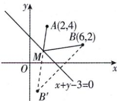
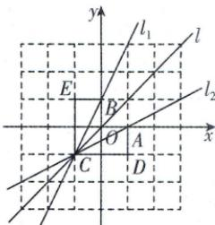

> [!faq]- 必刷题解析
> **【答案】** BD
>
> **【解析】**
> 由题可知点 A, B 在直线 $x + y - 3 = 0$ 的同侧，
设点 B 关于直线 $x + y - 3 = 0$ 的对称点为 $B'(a, b)$ ，如图所示.

则 $\left\{ \begin{array}{l} \frac{a + 6}{2} + \frac{b + 2}{2} - 3 = 0, \\ \frac{b - 2}{a - 6} \times (-1) = -1, \end{array} \right.$ 解得 $\left\{ \begin{array}{l} a = 1, \\ b = -3, \end{array} \right.$ 即 $B'(1, -3)$ . 要使将军走过的总路程最短，则将军从出发点到河边的路线所在直线即为直线 $AB'$ . 因为 $A(2,4)$ ，所以直线 $AB'$ 的方程为 $y + 3 = \frac{4 + 3}{2 - 1}(x - 1)$ ，即 $7x - y - 10 = 0$ ，故 A 错误设将军在河边饮马的地点为 $M$ ，则 $M$ $\Rightarrow \angle BCO = \angle ACO,$ 即 $OC$ 为两直线 $l_{1}$ 与 $l_{2}$ 夹角的角平分线，所以直线 $OC$ 符合题意，易知其方程为 $x - y = 0$ 当直线 $l$ 过点 $C$ 且与直线 $x - y = 0$ 垂直时，也符合题意，此时直线方程为 $x + y + 2 = 0.$

即为直线 $7x - y - 10 = 0$ 与 $x + y - 3 = 0$ 的交点，联立两直线方程解得 $M\left(\frac{13}{8}, \frac{11}{8}\right)$ ，故B正确.
将军从河边回军营的路线所在直线为直线BM，又 $B(6,2)$ ，所以直线BM的方程为 $y - 2 = \frac{\frac{11}{8} - 2}{\frac{13}{8} - 6}(x - 6)$ ，即 $x - 7y + 8 = 0$ ，故C错误.
总路程 $|MA| + |MB| = |MA| + |MB'| = |AB'| = \sqrt{(2 - 1)^2 + (4 + 3)^2} = 5\sqrt{2}$ ，所以“将军饮马”走过的总路程为 $5\sqrt{2}$ ，故D正确.
>
> 故选 **BD**.

对应题目：[Q070000004144](../Q070000004144.md)

> 来源：2026版 必刷题 数学选择性必修第一册RJA
