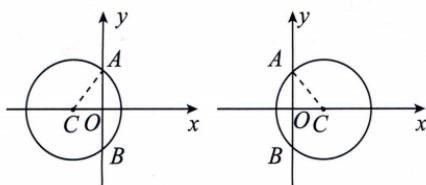

> [!faq]- 必刷题解析
> **【解析】**
> 1 【解析】由题意可得,圆 C 的圆心坐标为 $(2,4-m)$ , 半径为 1, 圆 C 上的点到原点的最短距离是圆心到原点的距离减去半径 1, 即 $d_{\min} = \sqrt{2^{2} + (4 - m)^{2}} - 1$ ,
>
> ---
> **🔔 敲黑板**
> $(0-2)^{2} + (m-4)^{2} > 1$ , 所以原点在圆 C 的外部
当 m=4 时, $d_{\min}$ 最小, 此时 $d_{\min} = 1$ .

## 刷易错

## ★易错点 对圆的标准方程的结构形式把握不准致误

对应题目：[Q070000004155](../Q070000004155.md)

> 来源：2026版 必刷题 数学选择性必修第一册RJA
