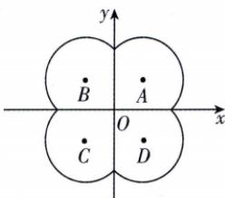

> [!faq]- 必刷题解析
> **【答案】** B
>
> **【解析】**
>
> ---
> **🎯 思路导引**
> 曲线方程中有绝对值,首先要去掉绝对值符号,分 $x \geqslant 0, y \geqslant 0; x < 0, y > 0; x < 0, y < 0; x > 0, y < 0$ 四种情况写出曲线方程,再作出曲线,求出周长.
【解析】曲线 $x^{2} + y^{2} = 4|x| + 4|y| =$ $\left\{ \begin{array}{l}(x - 2)^{2} + (y - 2)^{2} = 8(x\geqslant 0,y\geqslant 0),\\ (x + 2)^{2} + (y - 2)^{2} = 8(x <   0,y > 0),\\ (x + 2)^{2} + (y + 2)^{2} = 8(x <   0,y <   0),\\ (x - 2)^{2} + (y + 2)^{2} = 8(x > 0,y <   0), \end{array} \right.$
作出曲线如图所示,该图是以 A, B, C, D 四个点为圆心, 半径为 $2\sqrt{2}$ 的四个半圆, 所以该曲线的周长为 $4 \times \pi \times 2\sqrt{2} = 8\sqrt{2}\pi$ . 故选 B.

对应题目：[Q070000004160](../Q070000004160.md)

> 来源：2026版 必刷题 数学选择性必修第一册RJA
