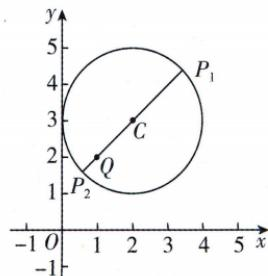
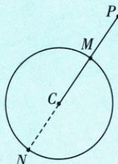

> [!faq]- 2026版 必刷题 数学选择性必修第一册RJA
> **【答案】** C
>
> **【解析】**
> 将圆 $C: x^{2} + y^{2} - 4x - 6y + 9 = 0$ 化为标准方程, 得 $(x-2)^{2}+(y-3)^{2}=4$ ,
> 故圆 C 的圆心为 $C(2,3)$ ，半径 r=2.
> 因为 $(1-2)^{2}+(2-3)^{2}=2<4$ ，所以点
> $Q(1,2)$ 在圆 C 的内部，
> 且 $|CQ|=\sqrt{(1-2)^{2}+(2-3)^{2}}=\sqrt{2}$ ，所以 $|PQ|$ 的取值范围为 $\left[r-\left|CQ\right|,r+\right|CQ|\left\rbrack=\left[2-\sqrt{2},2+\sqrt{2}\right]\right]$
>
> ---
> **💡 点悟**
> 涉及与圆相关的两点的距离问题，总是转化为圆心与定点距离问题来解决
> 故选C.
> 
>
> ---
> **📝 归纳总结**
> 此类题一般都是转化为点到圆心的距离处理,加半径为最大值,减半径为最小值.
> 已知圆 C 及圆外一定点 P, 设圆 C 的半径为 r, 则圆上点到点 P 距离的最小值为 $\left|PM\right| = \left|PC\right| - r$ , 最大值为 $\left|PN\right| = \left|PC\right| + r$ , M 为线段 PC 与圆的交点, N 为 PC 延长线与圆的交点.
> 
