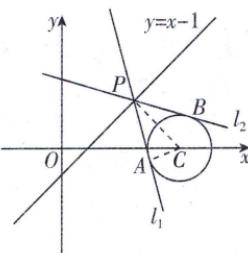

> [!faq]- 必刷题解析
> **【答案】** C
>
> **【解析】**
> 如图所示, 圆心 $C(5,0)$ , 连接 $CP, CA$ , 因为直线 $l_1, l_2$ 关于直线 $y = x - 1$ 对称, 所以 $CP$ 垂直于直线 $y = x - 1$ , 故 $|CP| = \frac{|5 - 1|}{\sqrt{2}} = 2\sqrt{2}$ , 而 $|AC| = \sqrt{2}$ , 则 $|PA| = \sqrt{|CP|^2 - |CA|^2} = \sqrt{6}$ . 故选 C.

对应题目：[Q070000004183](../Q070000004183.md)

> 来源：2026版 必刷题 数学选择性必修第一册RJA
