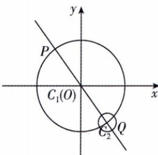
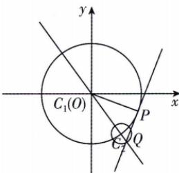

> [!faq]- 必刷题解析
> **【答案】** ACD
>
> **【解析】**
> 对于A,由圆 $C_{1}$ 的方程知,圆心 $C_{1}(0,0)$ ,半径 $r_{1}=5$ ;
圆 $C_{2}$ 的方程化成标准方程为 $(x-3)^{2}+(y+4)^{2}=1$ ，所以圆心 $C_{2}(3,-4)$ ，半径 $r_{2}=1$ .
因为两圆圆心距 $\left|C_{1}C_{2}\right|=\sqrt{(3-0)^{2}+(-4-0)^{2}}=5$ ，且 $r_{1}-r_{2}<|C_{1}C_{2}|<r_{1}+r_{2}$ 所以圆 $C_{1}$ 与圆 $C_{2}$ 相交，故 A 正确.
对于 B, 如图①所示,

图①
当线段 PQ 同时经过两圆圆心且点 P, Q 分别在两圆圆心两侧时， $|PQ|$ 取得最大值， $|PQ|_{\max} = |C_1 C_2| + r_1 + r_2 = 5 + 5 + 1 = 11$ ，故 B 错误.
对于 C，两圆方程作差，得两圆公共弦所在直线方程为 6x-8y-49=0，
又圆心 $C_{1}$ 到直线 6x-8y-49=0 的距离 $d=\frac{|-49|}{\sqrt{6^{2}+(-8)^{2}}}=\frac{49}{10}$ 所以两圆的公共弦长为 $2\sqrt{r_{1}^{2}-d^{2}}=$ 垂径定理 $2\sqrt{5^{2}-\left(\frac{49}{10}\right)^{2}}=\frac{3\sqrt{11}}{5}$ ，故 C 正确.
对于 D，如图②所示，

图②
当直线 $PQ$ 与圆 $C_1$ 相切时，点 $Q$ 在圆 $C_1$ 外，因为 $\mid PQ\mid^2 = \mid C_1Q\mid^2 -r_1^2$ ，所以当 $|C_1Q|$ 取得最大值时， $\mid PQ\mid$ 取得最大值.
因为 $|C_{1}C_{2}|=5$ ，所以点 $C_{2}$ 在圆 $C_{1}$ 上，所以 $|C_{1}Q|$ 的最大值为 $r_{1}+r_{2}=6$ ，所以 $|PQ|$ 的最大值为 $\sqrt{6^{2}-5^{2}}=\sqrt{11}$ ，故D正确.
>
> 故选 **ACD**.

对应题目：[Q070000004206](../Q070000004206.md)

> 来源：2026版 必刷题 数学选择性必修第一册RJA
