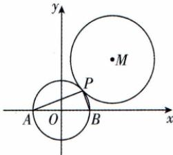

> [!faq]- 2026版 必刷题 数学选择性必修第一册RJA
> **【答案】** C
>
> **【解析】**
> 如图, 构造圆 $O: x^{2} + y^{2} = 4$ , 当圆 O 与圆 M 有公共点 P 时, [148]
> $\angle APB = \frac{\pi}{2}$ , 即圆 $O$ 与圆 $M$ 的关系可以为相切或相交, 所以 $\left\{ \begin{array}{l}3 - 2 \leqslant \sqrt{a + a} \leqslant 3 + 2, \\ a \geqslant 0, \end{array} \right.$ 解得 $\frac{1}{2} \leqslant a \leqslant \frac{25}{2}$ . 故选 C.
> 
