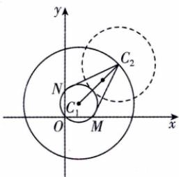

> [!faq]- 必刷题解析
> **【答案】** A
>
> **【解析】**
> 对于圆 $C_{1}: x^{2} + y^{2} - 2x - 2y = 0$ ，整理可得圆 $C_{1}: (x - 1)^{2} + (y - 1)^{2} = 2$ ，
可知圆心 $C_{1}(1,1)$ ，半径为 $\sqrt{2}$ 。令 x = 0，则 $y^{2}-2y=0$ ，解得 y=0 或 y=2，即 $N(0,2)$ ；
令 y=0，则 $x^{2}-2x=0$ ，解得 x=0 或 x=2，即 $M(2,0)$ .
因为圆 $C_{1}$ 与 $C_{2}$ 相外切，所以 $\left|C_{1}C_{2}\right|=\sqrt{2}+2\sqrt{2}=3\sqrt{2}$ ，可知点 $C_{2}(x,y)$ 的轨迹为以 $C_{1}$ 为圆心， $3\sqrt{2}$ 为半径的圆，则点 $C_{2}$ 的轨迹方程为 $(x-1)^{2}+(y-1)^{2}=18$ ，
可得 $\left|C_{2}M\right|^{2}+\left|C_{2}N\right|^{2}=\left[(x-2)^{2}+y^{2}\right]+\left[x^{2}+(y-2)^{2}\right]=2\left[(x-1)^{2}+(y-1)^{2}\right]+4=40$ 则 $\left|C_{2}M\right|\cdot\left|C_{2}N\right|\leqslant\frac{\left|C_{2}M\right|^{2}+\left|C_{2}N\right|^{2}}{2}=$ 20，当且仅当 $\left|C_{2}M\right|=\left|C_{2}N\right|=2\sqrt{5}$ 时等号成立，
所以 $\left|C_{2}M\right|\cdot\left|C_{2}N\right|$ 的最大值为 20。故选 A.

对应题目：[Q070000004217](../Q070000004217.md)

> 来源：2026版 必刷题 数学选择性必修第一册RJA
