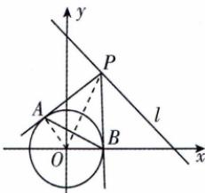

> [!faq]- 必刷题解析
> **【答案】** ABC
>
> **【解析】**
> 对于 A, 点 $P(2,4)$ , 连接 OA, OB, OP, 则 $OA \perp PA, OB \perp PB$ ,

故 $A, B$ 在以 $OP$ 为直径的圆上，而 $|OP| = 2\sqrt{5}$ ，则以 $OP$ 为直径的圆的方程为 $(x - 1)^2 + (y - 2)^2 = 5$ ，将方程 $(x - 1)^2 + (y - 2)^2 = 5$ 和 $x^2 + y^2 = 4$ 相减得 $2x + 4y - 4 = 0$ ，即直线 $AB$ 的方程为 $x + 2y - 2 = 0$ ，A 正确；对于 B，由题意知 $|OA| = 2$ ，则四边形 $PAOB$ 的面积 $S = 2 \times \frac{1}{2} |OA| \cdot |PA| = 2 |PA| = 2\sqrt{|PO|^2 - 4}$ ，而 $|PO|$ 的最小值即为原点 $O$ 到直线 $l: x + y - 6 = 0$ 的距离 $d = \frac{|-6|}{\sqrt{2}} = 3\sqrt{2}$ ，故四边形 $PAOB$ 的面积的最小值为 $2\sqrt{(3\sqrt{2})^2 - 4} = 2\sqrt{14}$ ，B 正确；对于 C，设 $P(a, b)$ ，则以 $OP$ 为直径的圆的方程为 $x(x - a) + y(y - b) = 0$ ，与 $x^2 + y^2 = 4$ 相减，即得直线 $AB$ 的方程为 $ax + by = 4$ ，又 $a + b - 6 = 0$ ，故 $ax + (6 - a)y = 4$ ，即 $a(x - y) + 6y - 4 = 0$ ，令 $\left\{ \begin{array}{l} x - y = 0, \\ 6y - 4 = 0, \end{array} \right.$ 得 $x = y = \frac{2}{3}$ ，即直线 $AB$ 过定点 $\left(\frac{2}{3}, \frac{2}{3}\right)$ ，设为 $E$ ，则 $|OE| = \frac{2\sqrt{2}}{3}$ ，当 $AB \perp OE$ 时， $|AB|$ 最小，最小值为 $2\sqrt{4 - \left(\frac{2\sqrt{2}}{3}\right)^2} = \frac{4\sqrt{7}}{3}$ ，C 正确；对于 D，在四边形 $PAOB$ 中， $\angle AOB$ 不一定是直角，故点 $O$ 不一定在以线段 $AB$ 为直径的圆上，D 错误
>
> 故选 **ABC**.

对应题目：[Q070000004218](../Q070000004218.md)

> 来源：2026版 必刷题 数学选择性必修第一册RJA
