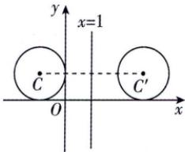

> [!faq]- 必刷题解析
> **【答案】** B
>
> **【解析】**
> 圆 $(x+1)^{2}+(y-1)^{2}=1$ 的圆心为C(-1,1)，半径r=1.
设点 C(-1,1) 关于直线 x=1 的对称
点为 $C'(a,b)$ ，则 $\left\{\begin{aligned}-\frac{-1+a}{2}&=1,\\ b&=1,\end{aligned}\right.$ 解得 $\left\{\begin{aligned}a=3,\\ b=1,\end{aligned}\right.$ 故 $C'(3,1)$ ，则圆 $C'$ 的方程为 $(x-3)^{2}+(y-1)^{2}=1$ . 故选 B.

对应题目：[Q070000004233](../Q070000004233.md)

> 来源：2026版 必刷题 数学选择性必修第一册RJA
