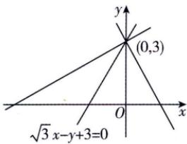

> [!faq]- 必刷题解析
> **【答案】** D
>
> **【解析】**
> 因为直线 $\sqrt{3}x - y + 3 = 0$ 的斜率为 $\sqrt{3}$ ，所以倾斜角为 $\frac{\pi}{3}$ .
因为直线 l 过点 $(0,3)$ ，且与直线 $\sqrt{3}x-y+3=0$ 及 x 轴围成等腰三角形，

所以当等腰三角形的腰在 x 轴上时, 直
→ 遗坑: 不确定等腰三角形的腰, 所以需要分类讨论$\left(x - \frac{1}{2}\right)^2 + y^2 = 1.$
>
> 故选 **A**.

对应题目：[Q070000004234](../Q070000004234.md)

> 来源：2026版 必刷题 数学选择性必修第一册RJA
