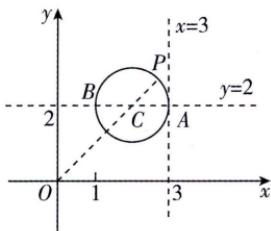

> [!faq]- 必刷题解析
> **【答案】** B
>
> **【解析】**
> 由直线 $kx-y-3k+2=0$ 与直线 $x+ky-2k-1=0$ ，知 $k\cdot1+(-1)\cdot k=0$ ，所以两直线垂直，又直线 $kx-y-3k+2=0$ 过定点 $A(3,2)$ ，直线 $x+ky-2k-1=0$ 过定点 $B(1,2)$ ，所以 $PA\perp PB$ ，故交点 P 的轨迹是以 AB 为直径的圆 C（去掉点 $A(3,2)$ ），如图所示，其中圆心 $C(2,2)$ ，半径为 1，所以 $|OP|$ 的最大值为 $|OC|+1=2\sqrt{2}+1$ ，此时点 P 存在，符合题意。故选 B.

对应题目：[Q070000004235](../Q070000004235.md)

> 来源：2026版 必刷题 数学选择性必修第一册RJA
