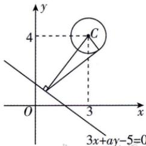

> [!faq]- 必刷题解析
> **【答案】** C
>
> **【解析】**
> 由圆 $C:(x-3)^{2}+(y-4)^{2}=1$ ，得圆心 $C(3,4)$ ，过直线 $l:3x+ay-5=0$ 上任意一点作圆 C 的切线，要使切线长最小，即要使圆心到直线 l 上的点的距离最小，最小值为圆心到直线 l 的距离，根据题意作图，如图所示.

∵圆的半径为1,切线长的最小值为 $\sqrt{15}$ ,∴圆心C到直线l的距离等于 $\sqrt{1^{2}+(\sqrt{15})^{2}}=4.$ 由点到直线的距离公式得 $\frac{|3\times3+4a-5|}{\sqrt{9+a^{2}}} = 4$ , 解得 a = 4. 此时直线 l 的斜率为 $-\frac{3}{4}$ .
>
> 故选 **C**.

对应题目：[Q070000004237](../Q070000004237.md)

> 来源：2026版 必刷题 数学选择性必修第一册RJA
