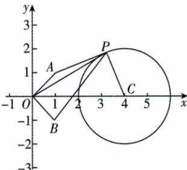

> [!faq]- 2026版 必刷题 数学选择性必修第一册RJA
> **【解析】**
> $2 - \sqrt{3}$ 【解析】 $\frac{S_{\triangle OAP}}{S_{\triangle OBP}} =$ $\frac{\frac{1}{2} |OA||OP|\sin\angle AOP}{\frac{1}{2} |OB||OP|\sin\angle BOP} = \frac{\sin\angle AOP}{\sin\angle BOP},$
>
> ---
> **💡 点悟**
> 利用三角形面积公式化面积比为角的正弦比，从而找相切位置分析
> 显然，当 OP 与圆 $C: (x-4)^{2} + y^{2} = 4$ 相切且切点在 x 轴上方时，比值最小.
> 在 Rt△OPC 中，|OC|=4, |CP|=2,
> ∴ $\angle COP = 30^{\circ}$ ，结合 A, B 两点坐标，
> 易知 $\angle AOP = 15^{\circ}, \angle BOP = 75^{\circ}$ ,
> ∴ $\frac{\sin\angle AOP}{\sin\angle BOP}=\frac{\sin15^{\circ}}{\sin75^{\circ}}=\tan15^{\circ}=2-\sqrt{3}.$
> 
