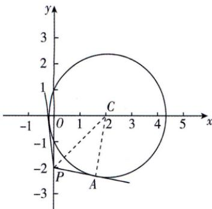

> [!faq]- 2026版 必刷题 数学选择性必修第一册RJA
> **【答案】** B
>
> **【解析】**
> 设圆 $x^{2}+y^{2}-4x-1=0$ 为圆 C，化简得 $(x-2)^{2}+y^{2}=5$ ，圆心为 $C(2,0)$ ，半径 $r=\sqrt{5}$ 。如图，设 $\angle CPA=$
> $\theta$ ，则 $\alpha = 2\theta$ ， $\sin \theta = \frac{|CA|}{|CP|} =$ $\frac{\sqrt{5}}{\sqrt{(2 - 0)^2 + [0 - (-2)]^2}} = \frac{\sqrt{5}}{2\sqrt{2}}$ 易知cos $\theta >0$ ，则cos $\theta = \frac{\sqrt{3}}{2\sqrt{2}}$ 所以sin $\alpha =$ 点悟： $\theta \in \left(0,\frac{\pi}{2}\right)$ sin $2\theta = 2\sin \theta \cos \theta = \frac{\sqrt{15}}{4}$ 故选B.
> 
