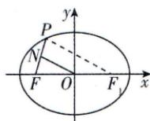

> [!faq]- 2026版 必刷题 数学选择性必修第一册RJA
> **【答案】** A
>
> **【解析】**
> 如图, 不妨设 F 为左焦点, $F_{1}$ 为右焦点, 连接 $PF_{1}$ . ∵ N 为 PF 的中点, 且 $|ON|=2$ , ∴ $|PF_{1}|=4$ . 由椭圆方程可知, 2a=6, 根据椭圆定义有 $|PF|+|PF_{1}|=2a=6$ , ∴ $|PF|=2$ . 故选 A.
> 
