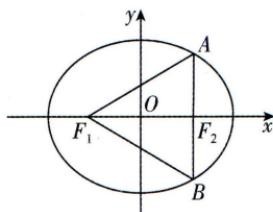

> [!faq]- 2026版 必刷题 数学选择性必修第一册RJA
> **【解析】**
> $\frac{x^2}{9} + \frac{y^2}{6} = 1$ 【解析】设 $F_{1}(-c,0)(c > 0)$ , 由题意知当 $AB \perp F_{1}F_{2}$ 时, $\triangle ABF_{1}$ 是边长为4的正三角形, 如图.
>
> ---
> **💡 点悟**
> 已知正三角形 $ABF_{1}$ 且 $\vert AF_{1}\vert = \vert BF_{1}\vert$ ，由椭圆的对称性可知 $F_{1}F_{2}$ 为正三角形的中线、高线、角平分线由椭圆和正三角形的对称性，可知【解析】由题知 $\odot C$ 的半径是2，圆心 $C$ 的坐标是(2,1).当 $m = 0$ 时，直线 $l$ ： $x = 0$ ，此时直线 $l$ 与圆 $C$ 相切，不满足题意，舍去.易知 $\triangle ABC$ 的面积最大时， $\angle ACB = 90^{\circ}$ ，则此时圆心 $C$ 到直线 $l$ 的距离为 $\sqrt{2}$ ，所以 $\sqrt{2} = \frac{|2 + m + m|}{\sqrt{1 + m^2}}$ ，解得 $m = -2\pm$ $\sqrt{3}$ （写出其中之一即可）.
> $|F_{1}F_{2}|=2c=4\times\frac{\sqrt{3}}{2}=2\sqrt{3}$ ，所以 $c=\sqrt{3}$ .
> 又 $|AB| = |BF_{1}| = 2|BF_{2}| = 4$ ，则 $|BF_{1}| + |BF_{2}| = 2a = 6$ ，解得a=3，
> 由 $a^{2}-b^{2}=c^{2}$ ，得 $b^{2}=6$ ，故椭圆的方程为 $\frac{x^{2}}{9}+\frac{y^{2}}{6}=1$ .
> 
