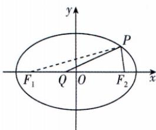

> [!faq]- 2026版 必刷题 数学选择性必修第一册RJA
> **【答案】** B
>
> **【解析】**
> 如图, 连接 $PF_{1}$ , 由椭圆的定义知 $\left|PF_{2}\right| + \left|PF_{1}\right| = 2a = 10$ , 则 $\left|PF_{2}\right| + \left|PQ\right| = 10 + \left|PQ\right| - \left|PF_{1}\right|$ ,
> 由图知, 当 P, Q, $F_{1}$ 三点共线, 且点 Q 在线段 $PF_{1}$ 上时, $\left|PQ\right| - \left|PF_{1}\right|$ 的值最小, 最小值为 $-\left|QF_{1}\right| = -(4-1) = -3$ , 此时, $\left|PF_{2}\right| + \left|PQ\right|$ 的最小值为 10-3=7. 故选 B.
> 
