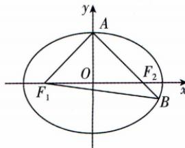

> [!faq]- 必刷题解析
> **【答案】** D
>
> **【解析】**
> 如图所示, 设 $\left|AF_{1}\right|=3t$ , 则 $\left|AB\right|=4t, \left|BF_{1}\right|=5t$ , $\therefore \left|AF_{1}\right|^{2}+\left|AB\right|^{2}=\left|BF_{1}\right|^{2}$ ,
得 $\angle F_{1}AF_{2}=90^{\circ}$ .
由椭圆定义可得 $\left|AF_{1}\right|+\left|AB\right|+\left|BF_{1}\right|=12t=4a,\therefore t=\frac{a}{3},\therefore\left|AF_{1}\right|=3t=a,\therefore\left|AF_{2}\right|=2a-\left|AF_{1}\right|=a,$ $\therefore \triangle AF_{1}F_{2}$ 为等腰直角三角形，得 $\left|AF_{1}\right|^{2}+\left|AF_{2}\right|^{2}=\left|F_{1}F_{2}\right|^{2},\therefore 2a^{2}=4c^{2}$ ，故该椭圆的离心率为 $e=\frac{c}{a}=\frac{\sqrt{2}}{2}$ . 故选 D.

对应题目：[Q070000004289](../Q070000004289.md)

> 来源：2026版 必刷题 数学选择性必修第一册RJA
