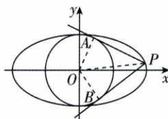

> [!faq]- 必刷题解析
> **【答案】** C
>
> **【解析】**
> 如图, 若在椭圆 $C_{1}$ 上存在点 P, 过点 P 作圆的切线 PA,
$PB$ ，切点为 $A,B$ ，使得 $\angle BPA = \frac{\pi}{3}$ 连接 $OA,OB,OP,$ 则 $\angle APO = \angle BPO = \frac{\pi}{6},$ 在 Rt△OAP 中， $\angle AOP = \frac{\pi}{3}$ $\therefore \cos \angle AOP = \frac{b}{|OP|} = \frac{1}{2},$ $\therefore |OP| = 2b.$ 又 $b < |OP|\leqslant a,\therefore 2b\leqslant a,$ $\therefore 4b^{2}\leqslant a^{2}$ ，即 $4(a^{2} - c^{2})\leqslant a^{2}$ ，即 $3a^{2}\leqslant 4c^{2}$ ，即 $\frac{c^2}{a^2}\geqslant \frac{3}{4},\therefore e\geqslant \frac{\sqrt{3}}{2}.$ 又因为 $e <   1$ ，所以椭圆 $C_1$ 的离心率的取值范围是 $\left[\frac{\sqrt{3}}{2},1\right)$ .故选C.

## 刷易错
★易错点 忽略椭圆中变量的取值范围而致错

对应题目：[Q070000004295](../Q070000004295.md)

> 来源：2026版 必刷题 数学选择性必修第一册RJA
