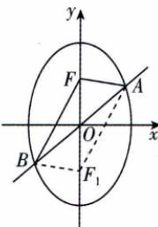

> [!faq]- 2026版 必刷题 数学选择性必修第一册RJA
> **【答案】** D
>
> **【解析】**
> 由椭圆的对称性可知 A, B 两点关于原点对称，设椭圆的另一个焦点为 $F_{1}$ ，连接 $AF_{1}, BF_{1}$ ，如图，
> 
> 则四边形 $AFBF_{1}$ 为平行四边形，
> 由椭圆的定义可知 $|AF|+|AF_{1}|+|BF|+|BF_{1}|=4a=12.$ 又 $|AF_{1}|=|BF|$ ， $|AF|=|BF_{1}|$ ，
> 所以 $|AF|+|BF|=6.$ 又直线AB过原点，所以 $|AB|_{\min}=2b=4$ 故黑板：过原点的直线与椭圆相交所得的弦长最短为椭圆的短轴长
> 所以 $\triangle ABF$ 的周长的最小值为 $4+6=10$ .
>
> 故选 **D**.
