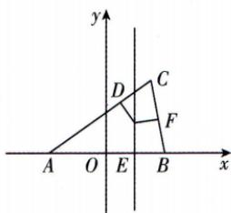

> [!faq]- 必刷题解析
> **【答案】** B
>
> **【解析】**
> 如图, 设 $\triangle ABC$ 与内切圆的切点分别为 D, E, F, 则有 $|AD| = |AE| = 3$ , $|BF| = |BE| = 1$ , $|CD| = |CF|$ , 所以 $|CA| - |CB| = 3 - 1 = 2 < |AB|$ .
根据双曲线的定义,所求轨迹是以A,
B为焦点,实轴长为2的双曲线的右支(右顶点除外),
→ 点悟: 点C不能在x轴上, 此时构不成三角形
即c=2,a=1,又 $c^{2}=a^{2}+b^{2}$ ,所以 $b^{2}=3$ ,所以轨迹方程为 $x^{2}-\frac{y^{2}}{3}=1(x>1)$ .故选B.

对应题目：[Q070000004338](../Q070000004338.md)

> 来源：2026版 必刷题 数学选择性必修第一册RJA
