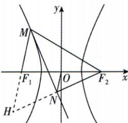

> [!faq]- 必刷题解析
> **【答案】** B
>
> **【解析】**
> 双曲线 $\frac{x^2}{4} -\frac{y^2}{12} = 1$ 的实半轴长 $a = 2$ 延长 $F_{2}N,MF_{1}$ 交于点 $H$

由题意可得 $|MH| = |MF_2|$ , $|NH| = |NF_2|$ . 又 $O$ 是 $F_{1}F_{2}$ 的中点, 所以 $|ON| = \frac{1}{2}|F_{1}H| = \frac{1}{2} (|MH| - |MF_{1}|) = \frac{1}{2} (|MF_{2}| - |MF_{1}|) = a = 2$ ,
>
> 故选 **B**.

对应题目：[Q070000004340](../Q070000004340.md)

> 来源：2026版 必刷题 数学选择性必修第一册RJA
