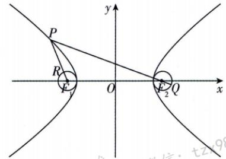

> [!faq]- 2026版 必刷题 数学选择性必修第一册RJA
> **【答案】** B
>
> **【解析】**
> 在双曲线 $C_1$ 中， $a = 4,b = 3,c = 5$ ，易知两圆圆心分别为双曲线 $C_1$ 的两个焦点，记点 $F_{1}(-5,0),F_{2}(5,0)$ ，当 $\mid PQ\mid -$ |PR|取最大值时， $P$ 在双曲线 $C_1$ 的左支上，如图所示，
> 
> $$
> \mid P Q \mid - \mid P R \mid \leqslant \mid P F _ {2} \mid + 1 -
> $$
> $(|PF_{1}|-1)=|PF_{2}|-|PF_{1}|+2=2a+$ 2=10.
>
> 故选 **B**.
