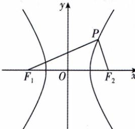

> [!faq]- 2026版 必刷题 数学选择性必修第一册RJA
> **【答案】** B
>
> **【解析】**
> 由题得 $S_{\triangle PF_{1}F_{2}}=\frac{1}{2}|PF_{1}|\cdot|PF_{2}|=4$ ，所以 $|PF_{1}|\cdot|PF_{2}|=8$ ，
> 因为 $F_{1}P \perp F_{2}P$ ，所以 $|PF_{1}|^{2} + |PF_{2}|^{2} = (2c)^{2}$
> 则 $\left(\left|PF_{1}\right|-\left|PF_{2}\right|\right)^{2}+2\left|PF_{1}\right|\cdot\left|PF_{2}\right|=4c^{2}$ ，所以 $4a^{2}+16=4c^{2}$ ，即 $a^{2}+4=c^{2}$ ，又 $c^{2}=a^{2}+b^{2}$ ，所以 $b^{2}=4$ ，即b=2。故选B.
> 
