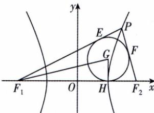
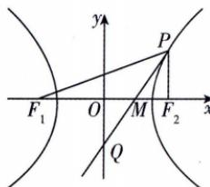

> [!faq]- 必刷题解析
> **【答案】** B
>
> **【解析】**
> 如图，设 $\triangle F_{1}PF_{2}$ 的内切圆的圆心为 $G$ ，内切圆与三边分别相切于点 $E,F,H$

可得 $\left|PF_{1}\right|-\left|PF_{2}\right|=\left|PE\right|+\left|EF_{1}\right|-\left|PF\right|-\left|FF_{2}\right|=\left|EF_{1}\right|-\left|FF_{2}\right|=$ $\left|F_{1}H\right|-\left|F_{2}H\right|=c+\left|OH\right|-(c-\left|OH\right|)=2\left|OH\right|=2a,$ 所以 $|OH|=a$ ，即 $\triangle F_{1}PF_{2}$ 的内切圆与x轴相切于双曲线的右顶点，即双曲线的右顶点为H.
设直线 l 的倾斜角为 $\theta$ ，则 $\theta = \angle PF_{1}F_{2} = 2\angle GF_{1}H$ ，则由内切圆的性
>
> ---
> **💡 点悟**
> 内切圆的圆心为角平分线的交点
质可知 $GH \perp x$ 轴，
所以在 Rt $\triangle GF_{1}H$ 中， $\tan \angle GF_{1}H = \frac{|GH|}{|HF_{1}|} = \frac{1}{a + c} = \frac{1}{2 + 3} = \frac{1}{5},$ 所以 $\tan\theta=\tan2\angle GF_{1}H=\frac{2\times\frac{1}{5}}{1-\left(\frac{1}{5}\right)^{2}}=\frac{5}{12}$ ，故选 B.
<table><tr><td>先由双曲线方程得到a,b,c的关系,再由PF2⊥x轴求得P(√2a,a)</td></tr><tr><td>设∠F1PF2的平分线与x轴交于点M,结合角平分线定理与双曲线的定义求得|MF1|/|MF2|=3</td></tr><tr><td>得到M(√2/2a,0)</td></tr><tr><td>由P,M,Q三点共线得到关于a的方程,求解即可得到a的值</td></tr></table>
【解析】由双曲线 $E: x^{2}-y^{2}=a^{2}$ 得 $\frac{x^{2}}{a^{2}}-\frac{y^{2}}{a^{2}}=1$ ，故 $a^{2}=b^{2}, c^{2}=a^{2}+b^{2}=2a^{2}$ ，即 $a=b, c=\sqrt{2}a, F_{1}(-c,0), F_{2}(c,0)$ ，设 $\angle F_{1}PF_{2}$ 的平分线与 x 轴交于点 M，如图。
因为 $PF_{2} \perp x$ 轴，所以可设 $P(c, y_{1}) (y_{1}>0)$ ，代入双曲线方程 $x^{2}-y^{2}=a^{2}$ 得
>
> ---
> **💡 点悟**
> 因为 P 在第一象限，所以 $y_{1}>0$ $c^{2}-y_{1}^{2}=a^{2}$ ，故 $y_{1}^{2}=c^{2}-a^{2}=b^{2}$ ，则 $y_{1}=b$ ，即 $P(c,b)$ ，即 $P(\sqrt{2}a,a)$ .
因为 $|PF_{1}|-|PF_{2}|=2a, |PF_{2}|=a$ ，所以 $|PF_{1}|=2a+|PF_{2}|=3a$ ，
又因为 PM 平分 $\angle F_{1}PF_{2}$ ，所以 $\frac{|MF_{1}|}{|MF_{2}|}=\frac{|PF_{1}|}{|PF_{2}|}=3.$ 又 $|MF_{1}| + |MF_{2}| = |F_{1}F_{2}| = 2c = 2\sqrt{2}a$ ，所以 $|MF_{2}| = \frac{\sqrt{2}}{2}a$ ，则 $|OM| = |OF_{2}| - |MF_{2}| = \frac{\sqrt{2}}{2}a$ ，即 $M\left(\frac{\sqrt{2}}{2}a,0\right)$ .
因为 P, M, Q 三点共线，所以 $k_{PM} = k_{PQ}$ ，即 $\frac{a}{\sqrt{2}a - \frac{\sqrt{2}}{2}a} = \frac{a+2}{\sqrt{2}a}$ ，解得 a=2。故选 C.

对应题目：[Q070000004348](../Q070000004348.md)

> 来源：2026版 必刷题 数学选择性必修第一册RJA
