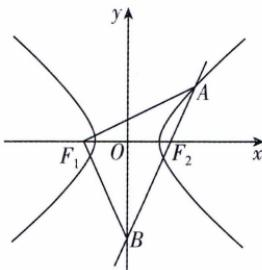

> [!faq]- 2026版 必刷题 数学选择性必修第一册RJA
> **【答案】** D
>
> **【解析】**
> 如图所示，设 $|BF_{1}|=m(m>0)$ ，由题意可得 $|BF_{2}|=m,|AF_{2}|=\frac{2}{3}m,|AF_{1}|=\frac{2}{3}m+2a.$ 又 $|AB|=|AF_{2}|+|BF_{2}|$ ，由 $AF_{1}\perp BF_{1}$ 可得 $|AF_{1}|^{2}+|BF_{1}|^{2}=|AB|^{2}$ ，
> 即 $\left(\frac{2}{3}m+2a\right)^{2}+m^{2}=\left(\frac{2}{3}m+m\right)^{2}$ ，解得m=3a或m=-a（舍），所以 $|AF_{2}|=2a,|AF_{1}|=4a,|BF_{1}|=3a.$ 因为 $\angle AF_{1}O+\angle BF_{1}O=90^{\circ},\angle BF_{1}O+$ $\angle F_{1}BO=90^{\circ}$ ，所以 $\angle AF_{1}O=\angle F_{1}BO$ 则 $\cos\angle AF_{1}O=\cos\angle F_{1}BO$ ，可得 $\frac{|AF_{1}|^{2}+|F_{1}F_{2}|^{2}-|AF_{2}|^{2}}{2|AF_{1}||F_{1}F_{2}|}=\frac{|OB|}{|BF_{1}|}$ 即 $\frac{16a^{2}+4c^{2}-4a^{2}}{2\times4a\times2c}=\frac{\sqrt{9a^{2}-c^{2}}}{3a}$ ，解得 $\frac{c}{a}=\frac{3\sqrt{5}}{5}$ . 故选D.
> 
