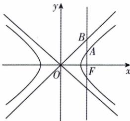

> [!faq]- 2026版 必刷题 数学选择性必修第一册RJA
> **【解析】**
> $\frac{2\sqrt{3}}{3}$ 【解析】双曲线 $\frac{x^2}{a^2} -\frac{y^2}{b^2} = 1(a>$ $0,b > 0)$ 的渐近线方程为 $y = \pm \frac{b}{a} x$
> 
> 由 $\left\{\begin{aligned}\frac{x^{2}}{a^{2}}-\frac{y^{2}}{b^{2}}=1,\\ x=c,\end{aligned}\right.$ 解得 $\left\{\begin{aligned}x=c,\\ y=\frac{b^{2}}{a}\end{aligned}\right.$ 或 $\left\{\begin{aligned}x=c,\\ y=-\frac{b^{2}}{a},\end{aligned}\right.$ 又 A 在第一象限，故 $A\left(c,\frac{b^{2}}{a}\right).$
> 由 $\left\{\begin{aligned}y=\frac{b}{a}x,\\ x=c,\end{aligned}\right.$ 解得 $\left\{\begin{aligned}x&=c,\\ y=\frac{bc}{a},\end{aligned}\right.\therefore B\left(c,\frac{bc}{a}\right).$ ∵ $F(c,0)$ ，点 A 是线段 FB 的中点，∴ $\frac{2b^{2}}{a}=\frac{bc}{a}$ ，∴ c=2b，
> ∴ $a=\sqrt{c^{2}-\frac{1}{4}c^{2}}=\frac{\sqrt{3}}{2}c$ ∴ $e=\frac{c}{a}=\frac{2\sqrt{3}}{3}.$
