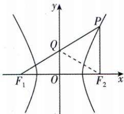

> [!faq]- 2026版 必刷题 数学选择性必修第一册RJA
> **【答案】** A
>
> **【解析】**
> 设 $PF_{1}$ 与 y 轴交于 Q 点，连接 $QF_{2}$ ，则 $\left|QF_{1}\right|=\left|QF_{2}\right|$ ，得到
>
> ---
> **💡 点悟**
> 垂直平分线的性质 $\angle QF_{1}F_{2}=\angle QF_{2}F_{1}$ 因为 $\angle PF_{2}F_{1}=3\angle PF_{1}F_{2}$ ，故 P 点在双曲线右支上，且 $\angle PF_{2}Q=\angle PQF_{2}=2\angle PF_{1}F_{2}$ ，故 $\left|PQ\right|=\left|PF_{2}\right|$ .
> 而 $\left|PF_{1}\right|-\left|PF_{2}\right|=2a$ ,
> 所以 $\left|PF_{1}\right|-\left|PF_{2}\right|=\left|PF_{1}\right|-\left|PQ\right|=\left|QF_{1}\right|=2a$ 在 Rt $\triangle QOF_{1}$ 中， $\left|QF_{1}\right|>\left|OF_{1}\right|$ ，即
> 2a>c, 故 $e=\frac{c}{a}<2$ .
> 由 $\angle PF_{2}F_{1}=3\angle PF_{1}F_{2}$ ，且三角形内角和为 $180^{\circ}$ ，
> 故 $\angle PF_{1}F_{2}<\frac{180^{\circ}}{4}=45^{\circ}$ 则 $\cos\angle PF_{1}F_{2}=\frac{\left|OF_{1}\right|}{\left|QF_{1}\right|}>\cos45^{\circ}$ 即 $\frac{c}{2a} > \frac{\sqrt{2}}{2}$ ，即 $e = \frac{c}{a} > \sqrt{2}$ ，所以 C 的离心率的取值范围为 $(\sqrt{2}, 2)$ ，故选 A.
> 
>
> ★易错点 忽视焦点位置的讨论而致错
