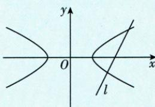
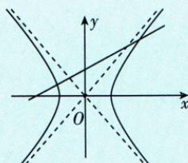
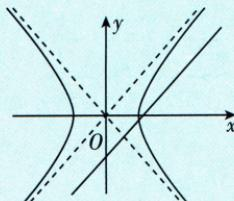
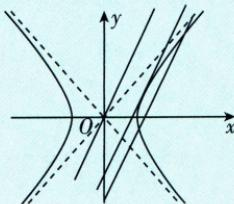

> [!faq]- 2026版 必刷题 数学选择性必修第一册RJA
> **【答案】** C
>
> **【解析】**
> 联立直线 l 与双曲线 C 的方程得 $\left\{\begin{aligned}y&=2x-8,\\ \frac{x^{2}}{4}-y^{2}&=1,\end{aligned}\right.$ 解得 $\left\{\begin{aligned}x=\frac{10}{3},\\ y=-\frac{4}{3}\end{aligned}\right.$ 或 $\left\{\begin{aligned}x&=\frac{26}{5},\\ y&=\frac{12}{5},\end{aligned}\right.$ 所以直线 l 与双曲线 C 的右支有两个公共点.
>
> 故选 **C**.
>
> ---
> **🔀 多种解法**
> 直线 l 的斜率为 2,2> $\frac{b}{a}=\frac{1}{2}$ ，又直线 l 与 x 轴的交点 (4,0) 在双曲线右顶点的右侧，故直线 l 与双曲线 C 的右支有两个交点. 故选 C.
> 
>
> ---
> **📚 二级结论**
> 设 l 是斜率为 k 的直线, 双曲线 $C: \frac{x^{2}}{a^{2}} - \frac{y^{2}}{b^{2}} = 1 (a > 0, b > 0)$ .
> (1) 如果 $|k| < \frac{b}{a}$ ，那么 l 与 C 有两个交点，它们分别在 C 的不同支上；
> 
> (2) 如果 $|k| = \frac{b}{a}$ 并且 $l$ 不是渐近线, 那么 $l$ 与 $C$ 有一个交点, 此交点不是切点;
> 
> (3) 如果 $\left|k\right|>\frac{b}{a}$ ，那么 l 与 C 交点的个数有三种可能: 0, 1, 2 (交点个数为 1 时, 交点是切点; 交点个数为 2 时, 两交点在 C 的同一支上).
> 
