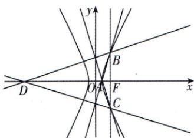

> [!faq]- 必刷题解析
> **【答案】** B
>
> **【解析】**
> 根据双曲线的对称性,不妨令点B在点C上方,如图.
由题意， $F(c,0)$ ， $A(a,0)$ ， $B\left(c,\frac{b^{2}}{a}\right)$ ， $C\left(c,-\frac{b^{2}}{a}\right)$ ，又由双曲线的对称性可知点D在x轴上，设 $D(x,0)$ .
则由 $BD \perp AC$ ，得 $\frac{b^{2}}{c-x} \cdot \frac{-b^{2}}{c-a} = -1$ ，整理得 $c-x=\frac{b^{4}}{a^{2}(c-a)}$ ，则D到直线BC的距离为 $\frac{b^{4}}{a^{2}(c-a)}$ 又 $\frac{b^{4}}{a^{2}(c-a)}>3(a+\sqrt{a^{2}+b^{2}})$ ，即 $b^{4}>3a^{2}(a+c)(c-a)\Rightarrow b^{2}>3a^{2}\Rightarrow b>\sqrt{3}a\Rightarrow\frac{b}{a}>\sqrt{3}$ . 故选 B.

对应题目：[Q070000004384](../Q070000004384.md)

> 来源：2026版 必刷题 数学选择性必修第一册RJA
