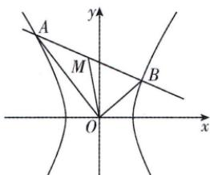
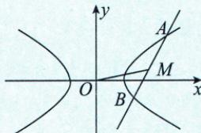

> [!faq]- 必刷题解析
> **【答案】** B
>
> **【解析】**
> 设点 $A(x_{1}, y_{1})$ , $B(x_{2}, y_{2})$ ，则有 $\frac{x_{1}^{2}}{a^{2}} - \frac{y_{1}^{2}}{b^{2}} = 1$ , $\frac{x_{2}^{2}}{a^{2}} - \frac{y_{2}^{2}}{b^{2}} = 1$ ,两式作差得 $\frac{x_1^2 - x_2^2}{a^2} = \frac{y_1^2 - y_2^2}{b^2}$ ，即 $\frac{(x_1 + x_2)(x_1 - x_2)}{a^2} = \frac{(y_1 + y_2)(y_1 - y_2)}{b^2}$ ，设 $M(x_0, y_0)$ ，则有 $x_1 + x_2 = 2x_0, y_1 + y_2 = 2y_0$ ，又 $k_{OM} = \frac{y_0}{x_0}, k = \frac{y_1 - y_2}{x_1 - x_2}$ ，代入整理得 $k \cdot k_{OM} = \frac{b^2}{a^2}$ ，即 $k_{OM} = \frac{b^2}{ka^2}$ 。由题意知 $\frac{b^2}{ka^2} < \frac{3}{k}$ ，因为 $k < 0$ ，所以 $\frac{b^2}{a^2} > 3, b^2 > 3a^2$ ，又 $b^2 = c^2 - a^2$ ，所以 $c^2 - a^2 > 3a^2$ ，解得 $c^2 > 4a^2$ ，即 $e^2 > 4$ ，则 $e > 2$ 。故选B.

>
> ---
> **📚 二级结论**
> 如图, 已知直线 l 与双曲线相交于 A, B 两点, 点 M 为 AB 的中点, O 为原点, 则 $k_{OM} \cdot k_{AB} = \frac{b^{2}}{a^{2}} = e^{2} - 1$ .

若直线 l 与双曲线的两条渐近线相交于 A, B 两点, 其他条件不变, 结论依然成立.

对应题目：[Q070000004387](../Q070000004387.md)

> 来源：2026版 必刷题 数学选择性必修第一册RJA
