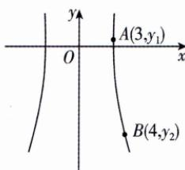

> [!faq]- 必刷题解析
> **【答案】** C
>
> **【解析】**
> 根据题意,作出冷却塔对应的双曲线,并建立相应的平面直角坐标系,如图所示,设双曲线方程为 $\frac{x^{2}}{a^{2}}-\frac{y^{2}}{b^{2}}=1(a>0,b>0)$ ,

因为冷却塔的上口半径为 $3\mathrm{m}$ ，下口半径为 $4\mathrm{m}$ ，高为 $8\mathrm{m}$ 所以设双曲线上的点 $A(3,y_{1})$ ， $B(4,y_2)$ ，且 $y_{1} - y_{2} = 8$ 将 $A,B$ 的坐标代入双曲线方程可得 $\left\{ \begin{array}{l} \frac{9}{a^2} -\frac{y_1^2}{b^2} = 1,\\ \frac{16}{a^2} -\frac{y_2^2}{b^2} = 1, \end{array} \right.$ 两式相减得 $\frac{7}{a^2} = \frac{y_2^2 - y_1^2}{b^2} =$ $\frac{(y_2 - y_1)(y_2 + y_1)}{b^2}$ ①.因为双曲线的离心率为3，所以 $\frac{b^2}{a^2} =$ $\frac{c^2 - a^2}{a^2} = e^2 -1 = 8$ ，所以 $b^{2} = 8a^{2}$ 代入①式可得 $\frac{7}{a^2} = \frac{-8(y_2 + y_1)}{8a^2}$ ，解得 $y_{2} + y_{1} = -7$ ，所以 $y_{1} = \frac{1}{2}$ 将点 $\left(3,\frac{1}{2}\right)$ 的坐标代入双曲线方程可得 $\frac{9}{a^2} -\frac{1}{32a^2} = 1$ ，解得 $a = \frac{\sqrt{574}}{8}$ 所以冷却塔的最小直径为 $2a = \frac{\sqrt{574}}{4}$
>
> 故选 **C**.

对应题目：[Q070000004399](../Q070000004399.md)

> 来源：2026版 必刷题 数学选择性必修第一册RJA
